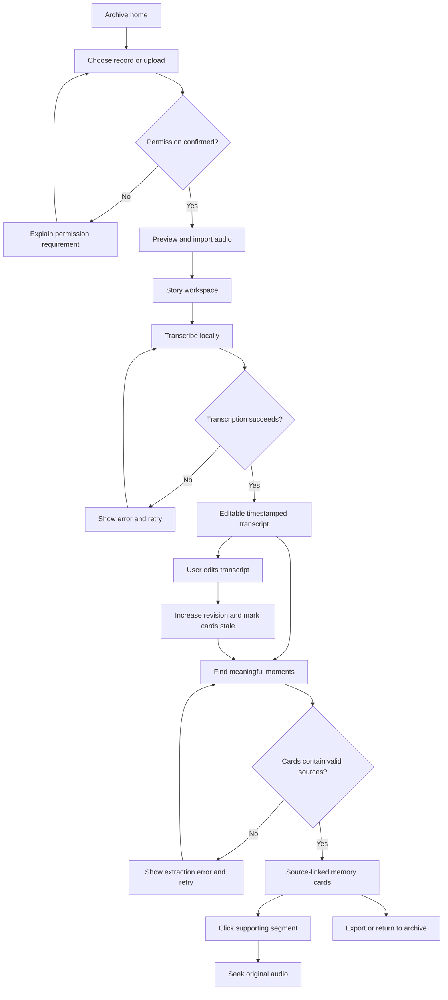

# EchoArchive — Application Flow & Interaction Map

**Status:** Intended MVP experience (not yet implemented)  
**North star:** The original person's voice is always one click away from an AI-generated memory.

## 1. Information architecture

```text
EchoArchive
├── Archive / Home
│   ├── Story collection + search
│   └── New story
│       ├── Record audio (permission first)
│       └── Upload existing recording
├── Story workspace / {story_id}
│   ├── Original audio player
│   ├── Transcript (read / correct)
│   ├── Find meaningful moments (local Qwen)
│   └── Memory cards with segment evidence
├── Story actions
│   ├── Export story archive
│   └── Delete story (confirmation)
└── Settings / diagnostics
    ├── Ollama readiness
    ├── Transcription engine readiness
    └── Local storage/privacy explanation
```

Avoid meaningless navigation: archive and workspace are the product, not a six-page marketing site.

## 2. Primary journey: a complete memory

| Step | Screen | User action | Visible feedback | Persistent outcome |
|---|---|---|---|---|
| 1 | Archive | Click **Preserve a story** | Import/record choice, privacy explanation | None |
| 2 | New story | Check permission acknowledgement | Consent wording remains explicit | Consent timestamp upon import |
| 3 | New story | Upload WAV/M4A/MP3/WebM or record with mic | Filename, size, estimated duration, playback preview | Audio saved under generated private ID |
| 4 | Story workspace | Click **Transcribe locally** | Real stages: queued → preparing → transcribing → saving | Timestamped transcript segments |
| 5 | Transcript | Read and correct recognition mistakes | Save state, revision indicator, no invented edits | New transcript revision |
| 6 | Memory desk | Click **Find meaningful moments** | Local Qwen processing state; no fake progress | Draft cards with valid sources |
| 7 | Memory card | Click **Hear source** | Highlight real transcript, seek original audio when timing reliable | No audio modifications |
| 8 | Archive | Search a word/phrase | Matching story/card snippets | Revisit anytime |
| 9 | Story actions | Export ZIP | Explicit download with included contents | User-owned copy |
| 10 | Story actions | Delete (optional) | Dialog warns that local story/audio will be removed | Rows and owned media removed, or explicit cleanup error |

## 3. Wireflow at a glance



## 4. Screen definitions

### S1 — Archive home

**Purpose:** Find an existing recording or create a new one.  
**Primary action:** Preserve a story.  
**Content:** One-line purpose, privacy indicator (local only), local-engine status, search field, story collection sorted by recent.  
**Card metadata:** title, optional user-provided speaker label, date recorded/added, duration if validated, processing status, card count.  
**Empty state:** "No stories preserved yet. Start with a short recording or import one you have permission to use." One real action button.

### S2 — New story

**Purpose:** Acquire audio safely.  
**Modes:** `Record` or `Upload`, not two confusing simultaneous forms.  
**Recording behavior:** Explicit click → browser permission prompt → visible elapsed time / recording state → Stop → preview / discard / import. No auto-recording on page load.  
**Upload behavior:** Choose supported audio; show filename, supported format, size and decoded duration only when known.  
**Required confirmation:** "I have permission to record or use this speaker's audio."  
**Submit action:** Save this recording.  
**Privacy notice:** "Audio and AI processing stay on this device. Local data is not automatically encrypted."  
**Errors:** microphone blocked (offer upload), empty recording, unsupported file, oversized/too long, FFmpeg unavailable.

### S3 — Story workspace

Desktop recommendation: original audio + story metadata across top; transcript on the left; Memory desk on the right. Mobile uses one accessible linear flow with visible tabs/sections and no split-screen overflow.

**Audio area:** play/pause, seek timeline, current time, duration, speed control only if tested.  
**Transcript:** numbered segments with timestamps, editable text, edit/Save/Cancel states and source anchors.  
**AI desk:** explains that cards are summaries, not quotations. "Find meaningful moments" requires a saved transcript and local model readiness.  
**Cards:** title, short summary, theme chips, **From the recording** source text and play action; draft/accepted state as appropriate.  
**Stale indicator:** "Transcript changed since these cards were generated. Regenerate to use the latest words." Do not silently mark stale cards as current.

### S4 — Search results

Search is local. Show original story title and matching transcript/card snippet. Clicking a result opens the story and highlights the relevant source. No external search indexing or analytics.

### S5 — Export / delete

Export: mention that ZIP contains original audio and transcript plus generated cards, and that the user is responsible for sharing it.  
Delete: confirmation states what is removed and whether backups/external exported copies remain outside EchoArchive. On failure, show which operation was incomplete without leaking local paths.

### S6 — Status and settings

Keep lightweight. Show whether local whisper.cpp, FFmpeg, Ollama, selected Qwen model and data storage are ready. For unavailable tools give verified setup guidance, not "AI ready" when a component is missing.

## 5. Processing state machine

```text
queued → running(preparing) → running(transcribing) → running(saving) → succeeded
                  └─────────────── error ─────────────────────────→ failed

queued → running(preparing) → running(extracting) → running(validating) → succeeded
                  └─────────────── error ─────────────────────────→ failed
```

- A running stage must reflect actual observed work; don't use fake percentage loading.
- Refreshing the page restores processing state from `GET /api/jobs/{job_id}`.
- Server restart changes stranded `queued`/`running` jobs to `failed: INTERRUPTED` on recovery (or a deliberate resumable strategy if implemented).
- A failed extraction never erases successfully saved audio/transcripts.
- Only one expensive job executes at once for MVP; a second job is queued or receives an honest busy response.

## 6. Transcript correction / card validity rules

1. Each segment belongs to one story and has a stable ID for the current saved transcript.
2. Save requires `expected_revision`. If someone edits from stale state, show conflict and offer reload without overwriting.
3. A successful correction increments the transcript revision and immediately marks prior cards stale.
4. AI extraction operates on a snapshot of the current transcript revision; if it changes during inference, refuse to commit outdated cards (or mark them stale on commit with a visible warning).
5. Card links only point to valid segments in the same story. Unsupported evidence is a failure, never a decorative "source" badge.
6. Clicking source scrolls to text and seeks original audio if valid timestamps are available. Do not claim word-level accuracy for segment timestamps.

## 7. Failure and recovery paths

| Context | Error seen by user | Recovery |
|---|---|---|
| Mic permission denied | "Microphone access wasn't granted." | Use upload or change browser permissions |
| Unsupported / corrupt audio | "This recording couldn't be decoded locally." | Select a supported file |
| Audio duration exceeds policy | "Recordings must be five minutes or shorter." | Trim/select shorter audio |
| Model missing | "Local speech model is not installed." | Open setup instructions |
| Ollama offline | "Qwen is unavailable on this device." | Start Ollama and retry extraction |
| Transcription ambiguous | "Some words may be incorrect." | Review/edit transcript; don't auto-certify |
| Invalid memory evidence | "The suggested memory couldn't be linked to the source." | Retry extraction; keep transcript |
| Transcript edit during extraction | "Transcript changed while processing." | Regenerate using latest revision |
| Failed export | "Export could not be completed." | Retry; private archive unaffected |
| Delete partially failed | "Deletion wasn't fully completed." | Explain what remains and safe next step |

## 8. Keyboard, screen-reader and motion behavior

- Use real buttons and labels; tab order follows story input → audio → transcript → AI cards → export/delete.
- All dialogs support Escape, initial focus, focus trap, and restoration; destructive actions require explicit confirmation.
- Audio play buttons announce source and timestamp in accessible labels.
- Job statuses are politely announced; errors use assertive alerts without repeated announcements.
- No information conveyed only with color. Reduced-motion mode disables waveform flourish while preserving recording state text.
- Ensure at least 44px practical mobile touch targets wherever feasible and no horizontal overflow at 320px.

## 9. Genuine demo script mapped to the interface

1. Show archive empty state and local engines ready.
2. Import a **fictional** 30–60 second story (consent acknowledgment visible).
3. Run real local transcription; point out editable timestamped text.
4. Generate two or more source-linked memory cards with Qwen.
5. Open a card; click the source; replay the speaker's original audio segment.
6. Correct one transcript segment, demonstrate stale-card warning, regenerate if feasible.
7. Search for a phrase and export the story.

If actual recording quality makes source seeking imprecise, show that honestly and demonstrate text grounding first.

## 10. References

[PRD.md](PRD.md) · [TRD.md](TRD.md) · [BACKEND_SCHEMA.md](BACKEND_SCHEMA.md) · [UIUX_BRIEF.md](UIUX_BRIEF.md) · [IMPLEMENTATION_PLAN.md](IMPLEMENTATION_PLAN.md)
